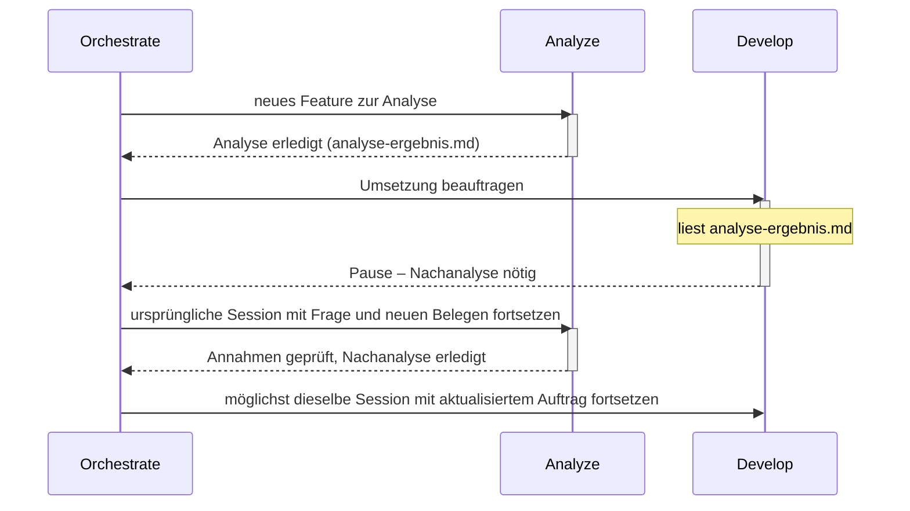

# Atlas

**Klare Rollen tragen komplexe Aufgaben.**

Atlas bietet klare Agent-Rollen für OpenCode. Frische Kontexte, gezielte Delegation und kompakte Übergaben halten größere Aufgaben übersichtlich. Planung, Analyse, Umsetzung und Ausführung greifen ineinander. Wichtige Erkenntnisse bleiben erhalten und erreichen die passende Rolle. Für transparente, fokussierte Zusammenarbeit.

## Der Grundgedanke

Ein guter Agent muss nicht die gesamte Unterhaltung, jeden Build-Log und alle Werkzeugantworten gleichzeitig im Kopf behalten. Atlas verteilt Arbeit auf klar beschriebene Rollen — nicht um Tokens um jeden Preis zu sparen, sondern um den Kontext einer Rolle so groß zu halten, wie die Aufgabe es erfordert. Neue eigenständige Aufgaben beginnen mit frischem Kontext und gezielter Übergabe, ohne Gesamtchat; zusammengehörige Folgefragen gehen möglichst an dieselbe Fachsession. Zurück kommen Ergebnis, belastbare Belege und wichtige neue Erkenntnisse.

Der Name greift das Bild des Atlas auf: Komplexe Aufgaben werden von einer nachvollziehbaren Struktur getragen. Die Rollen unterstützen einander; der Orchestrator hält den Gesamtauftrag zusammen.

## Die Rollen

| Rolle | Aufgabe |
|---|---|
| **Orchestrate** | Arbeit verteilen, Ergebnisse einordnen und den Nutzer auf dem Laufenden halten |
| **Plan** | Architektur, Lösungswege und Arbeitspakete entwickeln |
| **Analyze** | Zusammenhänge und Ursachen mit Belegen untersuchen |
| **Develop** | Abgegrenzte Änderungen umsetzen und passende Tests ergänzen |
| **Run** | Befehle, Tests, Dienste und MCP-Aufträge gemeinsam ausführen; große Ausgaben und Antworten verdichten |
| **Review** | Ergebnisse unabhängig auf Fehler und Regressionen prüfen |
| **Auto** | Ohne Rückfragen fast alle Werkzeuge nutzen und einen Auftrag eigenständig bearbeiten |
| **Build** | Wie Auto eigenständig arbeiten, aber vor jedem Shell-Befehl eine Nutzerbestätigung einholen |

Auto und Build eignen sich für zusammenhängende Arbeit in einer Session; Build fügt dabei eine Pflichtbestätigung vor jedem Shell-Befehl hinzu. Orchestrate koordiniert Aufgaben, die von gezielter Aufteilung profitieren. Ob Review dauerhaft als eigenständige Rolle bestehen bleibt oder nur noch begrenzt optional zum Einsatz kommt, ist offen; bis dahin gilt die Rolle unverändert wie oben beschrieben.

## Kontext wird bei Bedarf geladen

Der globale Einstieg bleibt kurz. Ein Agent erhält sein eigenes Rollenprofil; die Delegationsanleitung wird erst vor einer Delegation gelesen, die Artefaktanleitung bei großen Ausgaben, Git-Regeln erst bei tatsächlicher Repository-Arbeit.

Rohdaten bleiben beim ausführenden Spezialisten oder in gezielt referenzierten Artefakten. Wichtige Zusatzfunde gehen als Beleg, Bedeutung, Auswirkung und offene Fragen an den Parent. Im Hauptchat erscheinen kurze Ankündigungen und relevante Zwischenstände; der Nutzer muss keine Child-Sessions durchsuchen.

Eine Fachsession wird nur bei erneutem fachlichem Bedarf fortgesetzt, nicht laufend. Die genauen Regeln zu Fortsetzung, Ersatzübergabe und Session-Zuordnung durch Orchestrate stehen in [SUBAGENTS.md](SUBAGENTS.md).

## Wenn eine Umsetzung neue Fragen aufwirft



Develop meldet eine Informationslücke oder widerlegte Annahme mit neuen Belegen und aktuellem Arbeits-/Commitstand an seinen Parent zurück; dieser setzt möglichst die ursprüngliche Analyze-Session fort und danach möglichst dieselbe Develop-Session mit aktualisiertem Auftrag. Das ist eine Rückgabe an den Parent, keine Rückdelegation an einen weiteren Analyze. Die genauen Regeln dazu (Ersatzübergabe, Zuständigkeiten, Umfangserweiterung) stehen in [SUBAGENTS.md](SUBAGENTS.md#gezielte-nachanalyse).

## Repository-Struktur

```text
.
├── AGENTS.md
├── SUBAGENTS.md
├── agents/       # Native OpenCode-V2-Rollen als Markdown
├── commands/     # /setup-atlas
├── skills/       # Wiederverwendbarer Setup-Ablauf
├── atlas.json.example  # Vorlage für persönliche Modellpräferenzen
├── guide/        # Bedarfsanleitungen: ARTIFACTS.md, MCP.md, PLANNING.md, REPOSITORIES.md
├── .github/workflows/release.yml  # Erstellt das Installations-ZIP und Release
├── README.md
├── LICENSE
└── .gitignore
```

Die Rollen verwenden das native Rollenformat von OpenCode. Modelle und persönliche MCP-Verbindungen sind nicht festgelegt.

## Installieren

Atlas wird als ZIP heruntergeladen und direkt in das OpenCode-
Konfigurationsverzeichnis entpackt. Voraussetzung ist OpenCode V2.

### Linux und macOS

```sh
curl -fL https://github.com/DevelopingMedo/atlas/releases/latest/download/atlas.zip -o atlas.zip
mkdir -p "$HOME/.config/opencode"
unzip -n atlas.zip -d "$HOME/.config/opencode/"
```

### Windows (PowerShell)

```powershell
Invoke-WebRequest -Uri "https://github.com/DevelopingMedo/atlas/releases/latest/download/atlas.zip" -OutFile "atlas.zip"
New-Item -ItemType Directory -Force -Path "$env:USERPROFILE\.config\opencode" | Out-Null
Expand-Archive -Path "atlas.zip" -DestinationPath "$env:USERPROFILE\.config\opencode"
```

Diese Befehle installieren das neueste veröffentlichte Release. Für eine
bestimmte Version ersetzt du die Download-URL durch beispielsweise
`https://github.com/DevelopingMedo/atlas/releases/download/v1.0.0/atlas.zip`.
Die URLs funktionieren, sobald das entsprechende Release veröffentlicht ist.
Bei einem abweichenden OpenCode-Konfigurationsverzeichnis passe das Ziel an.

Im ZIP liegen `agents/`, `commands/`, `skills/`, `guide/`, `AGENTS.md`,
`SUBAGENTS.md` und `atlas.json.example` direkt an der Wurzel. Nach dem
Entpacken befinden sich diese Dateien direkt unter `~/.config/opencode/`.
Es gibt keinen zusätzlichen `atlas-opencode/`-Ordner und kein Installationsskript.

Bestehende eigene Regeln in `AGENTS.md` führst du mit den Atlas-Regeln zusammen.
`unzip -n` überspringt vorhandene Dateien; PowerShell überschreibt sie ohne
`-Force` ebenfalls nicht. Zum Aktualisieren entpackst du die neue Version
zunächst separat und übernimmst die Änderungen zusammen mit deinen Anpassungen.
Die persönliche `atlas.json` ist kein ZIP-Inhalt und wird dadurch nicht ersetzt.
Danach eine neue OpenCode-Session beginnen und `/setup-atlas` aufrufen.

### Ein Release veröffentlichen

Nach dem Merge in `opencode` löst ein gepushter Versions-Tag den Workflow aus:

```sh
git switch opencode
git pull --ff-only
git tag v1.0.0
git push origin v1.0.0
```

`v1.0.0` ist ein Beispiel; verwende die gewünschte neue Versionsnummer.
Der Workflow erstellt ein GitHub-Release mit dem Asset **atlas.zip** aus
exakt dem getaggten Stand. `.gitignore`, `LICENSE` und `README.md` werden
nicht eingepackt, ebenso wenig die Workflow-Dateien unter `.github/`.
Die Lizenz bleibt im Repository und wird in der Release-Beschreibung verlinkt.

Verwende zur Installation das Asset `atlas.zip`. GitHubs automatisch erzeugtes
„Source code (zip)“ enthält dagegen das vollständige Repository in einem
zusätzlichen Ordner.

**OpenCode V2:** Die Rollendateien werden direkt erkannt. Für den Standardstart kann in der bestehenden `opencode.json` der Wert `"default_agent": "Orchestrate"` ergänzt werden. Orchestrate, Plan, Auto und Build sind als Hauptagent vorgesehen; alle acht können delegiert werden. Eingebaute Rollen bleiben verfügbar, solange sie nicht in der eigenen Konfiguration deaktiviert werden.

MCP-Tools und -Ressourcen sind nur für Auto und Run freigegeben. Diese Rollenregel gilt für alle MCP-Server und alle Betriebssysteme. Andere Rollen delegieren MCP-Aufträge an Run. Rollenbezogene Berechtigungen blenden die Werkzeuge aus und sperren Aufrufe, schalten aber nicht die Serverprozesse ab. Persönliche Endpunkte, Zugangsdaten und rechnerabhängige Installationen bleiben außerhalb der allgemeinen Agent-Regeln. Details: [guide/MCP.md](guide/MCP.md).

## Persönliches Setup

Mit `/setup-atlas` stimmst du Atlas auf deine verfügbaren Modelle ab. Wir empfehlen, das Setup nach der Installation durchzuführen. Steht in `atlas.json` der boolesche Wert `"atlas-setup": true`, entfällt der Setup-Hinweis. Fehlt die Datei oder ist das Flag nicht gesetzt, empfiehlt der Agent das Setup einmal pro Hauptsession und bearbeitet den Auftrag weiter. Subagents wiederholen den Hinweis nicht.

`/setup-atlas` wechselt in die vorhandene Rolle `Auto` und lädt den Skill [`setup-atlas`](skills/setup-atlas/SKILL.md). Er ermittelt die verfügbaren Modelle über `opencode models`, fragt die persönlichen Präferenzen gesammelt ab und speichert sie in `atlas.json` neben der mitgelieferten [`atlas.json.example`](atlas.json.example). Der Befehl kann bestehende Einstellungen aktualisieren. Anschließend kann wieder die vorherige Rolle ausgewählt werden.

Der Aufruf benötigt keine Argumente. Zusätzlicher Text wird als freier Einrichtungshinweis übernommen, beispielsweise `/setup-atlas Bitte nur Modelle meines OpenAI-Providers vorschlagen`. Es gibt keine festen Parameter oder Flags; offene Angaben werden im Dialog geklärt.

| Einstellung | Bedeutung |
|---|---|
| `atlas-setup` | `false` in der Vorlage; nach abgeschlossener Einrichtung `true`. Nur der boolesche Wert `true` unterdrückt den Setup-Hinweis. |
| `models.fast` | Bevorzugtes Modell für einfache Aufgaben |
| `models.standard` | Bevorzugtes Modell für normale Aufgaben |
| `models.deep` | Bevorzugtes Modell für anspruchsvolle Aufgaben |

Die Vorlage enthält `null` als Modellwerte: Es gibt damit keine persönliche Vorgabe. Modell-IDs haben die Form `provider/model`, gegebenenfalls mit einer unterstützten `#variant`. Die Stufe richtet sich nach dem Arbeitspaket, nicht nach der Rolle.

`atlas.json` bleibt lokal; `atlas.json.example` wird mitgeliefert. Den passenden
Git-Ignore-Eintrag für eine Projektinstallation findest du unten. Alternativ zum Skill kann die Vorlage manuell als `atlas.json` gespeichert und angepasst werden. Bei manueller Einrichtung setze abschließend `"atlas-setup": true` und belasse den Eintrag am Dateianfang, damit der Startcheck kurz bleibt. Die Datei speichert den Setup-Status und persönliche Präferenzen; sie ist keine OpenCode-Konfiguration und bewirkt noch keinen automatischen Modellwechsel oder eine automatische Zuordnung durch den Planner.

### Im Projekt verwenden

Entpacke das Release-ZIP nach `<projekt>/.opencode/`, um Rollen, Command und Skill nur in diesem Projekt bereitzustellen. Ergänze in der bestehenden `opencode.json` bzw. `opencode.jsonc` des Projektstamms den Eintrag `".opencode/AGENTS.md"` im Array `instructions`, damit die gemeinsamen Regeln bereits beim Start geladen werden. Erhalte vorhandene Einträge. Die relativen Verweise der Atlas-Anleitung beziehen sich auf `.opencode/`.

Die persönliche Datei liegt dann in `.opencode/atlas.json`. Ergänze dafür
`.opencode/atlas.json` in der vorhandenen `.gitignore` des Projekts; das
Installations-ZIP enthält keine `.gitignore`. Bei einer globalen und einer projektlokalen Atlas-Installation wird die projektlokale verwendet, einschließlich ihrer eigenen `atlas.json`. Die Einstellungen beider Installationen werden nicht zusammengeführt.

## Was die Dateien leisten

Atlas liefert Rollen, gemeinsame Arbeitsregeln und Bedarfsanleitungen. Die jeweilige Laufzeit bestimmt verfügbare Werkzeuge, Delegationstiefe und Berechtigungen; ist direkte Delegation nicht verfügbar, gibt die Rolle dem Parent eine konkrete Folgeanforderung zurück. Frischer Kontext, Zuständigkeiten und knappe Übergaben sind Anweisungen, keine Laufzeitprüfung.

Bei tatsächlicher Git-Arbeit gehören nachvollziehbare Commits zur Übergabe; eine temporäre Implementierung ohne autorisierte Originaländerung entsteht in einer separaten Kopie, ohne automatische Git-Initialisierung.

Die Rollendateien wurden strukturell auf ihre nativen Markdown-Formate, Verweise und Rollennamen geprüft; ein vollständiger Modelllauf ist nicht dokumentiert. Persönliche Konfigurationen (Modelle, Provider, MCP-Verbindungen) sind nicht Teil dieses Repositorys.

## Dokumentation

- [OpenCode V2: Agents](https://dev.opencode.ai/v2/docs/agents/)

## Lizenz

Atlas steht unter der **Apache License 2.0 mit Commons Clause 1.0**.
Beide Texte stehen gemeinsam in [LICENSE](LICENSE) und gelten zusammen;
Apache 2.0 ist keine separate Lizenzoption. Atlas ist damit Source available.

- Private und berufliche Nutzung, auch bei Kunden, ist kostenlos erlaubt.
- Mit Atlas entwickelte eigene Software darf verkauft werden. Die Lizenz
  beansprucht keine Rechte an unabhängig erstellten Arbeitsergebnissen.
- Änderungen und kostenlose Forks sind erlaubt. Bei Weitergabe müssen die
  Lizenz einschließlich Commons Clause sowie die relevanten Urheber- und
  Herkunftshinweise erhalten bleiben; geänderte Dateien sind zu kennzeichnen.
- Atlas oder einen Fork als „Better Atlas“ zu verkaufen, ist ohne gesonderte
  Erlaubnis nicht gestattet, wenn der Wert des Angebots vollständig oder
  wesentlich aus Atlas stammt. Das gilt auch für entsprechend geprägte
  kostenpflichtige Hosting-, Beratungs- und Supportangebote.

Für eine gesonderte Verkaufserlaubnis und die zugehörigen Konditionen kontaktiere
[Medough / DevelopingMedo](https://github.com/DevelopingMedo).
Diese Zusammenfassung ersetzt nicht den verbindlichen Text in [LICENSE](LICENSE).

Der Lizenzwechsel gilt ab dem Commit, der ihn einführt. Bereits unter MIT
veröffentlichte Versionen behalten ihre bisherigen Nutzungsrechte. Der letzte
Stand vor dem Wechsel ist
[`2e65061`](https://github.com/DevelopingMedo/atlas/commit/2e650613a5ade4049d4c263888a3132acaed89f4).
