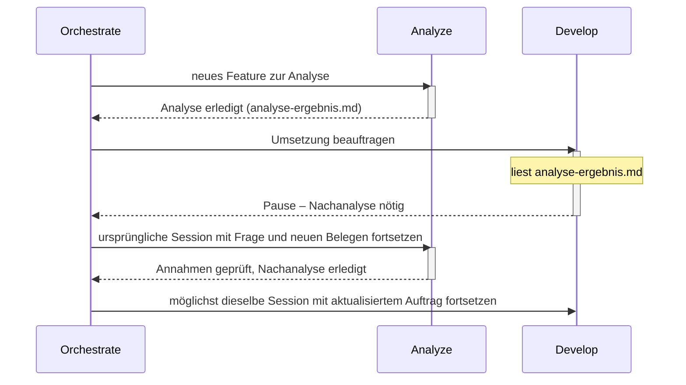

# Atlas

**Klare Rollen tragen komplexe Aufgaben.**

Atlas bietet klare Agent-Rollen für OpenCode. Frische Kontexte, gezielte Delegation und kompakte Übergaben halten größere Aufgaben übersichtlich. Planung, Analyse, Umsetzung und Ausführung greifen ineinander. Wichtige Erkenntnisse bleiben erhalten und erreichen die passende Rolle. Für transparente, fokussierte Zusammenarbeit.

## Der Grundgedanke

Ein guter Agent muss nicht die gesamte Unterhaltung, jeden Build-Log und alle Werkzeugantworten gleichzeitig im Kopf behalten. Atlas verteilt Arbeit auf klar beschriebene Rollen — nicht um Tokens um jeden Preis zu sparen, sondern um den Kontext einer Rolle so groß zu halten, wie die Aufgabe es erfordert. Neue eigenständige Aufgaben beginnen mit frischem Kontext und gezielter Übergabe, ohne Gesamtchat; zusammengehörige Folgefragen gehen möglichst an dieselbe Fachsession. Zurück kommen Ergebnis, belastbare Belege und wichtige neue Erkenntnisse.

Der Name greift das Bild des Atlas auf: Komplexe Aufgaben werden von einer nachvollziehbaren Struktur getragen. Die Rollen unterstützen einander; der Orchestrator hält den Gesamtauftrag zusammen.

## Die Rollen

| Rolle | Aufgabe |
|---|---|
| **Orchestrate** | Arbeit verteilen, Ergebnisse einordnen und den Nutzer auf dem Laufenden halten |
| **Plan** | Architektur, Lösungswege und Arbeitspakete entwickeln |
| **Analyze** | Zusammenhänge und Ursachen mit Belegen untersuchen |
| **Develop** | Abgegrenzte Änderungen umsetzen und passende Tests ergänzen |
| **Run** | Befehle, Tests, Dienste und MCP-Aufträge gemeinsam ausführen; große Ausgaben und Antworten verdichten |
| **Review** | Ergebnisse unabhängig auf Fehler und Regressionen prüfen |
| **Auto** | Ohne Rückfragen fast alle Werkzeuge nutzen und einen Auftrag eigenständig bearbeiten |
| **Build** | Wie Auto eigenständig arbeiten, aber vor jedem Shell-Befehl eine Nutzerbestätigung einholen |

Auto und Build eignen sich für zusammenhängende Arbeit in einer Session; Build fügt dabei eine Pflichtbestätigung vor jedem Shell-Befehl hinzu. Orchestrate koordiniert Aufgaben, die von gezielter Aufteilung profitieren. Ob Review dauerhaft als eigenständige Rolle bestehen bleibt oder nur noch begrenzt optional zum Einsatz kommt, ist offen; bis dahin gilt die Rolle unverändert wie oben beschrieben.

## Kontext wird bei Bedarf geladen

Der globale Einstieg bleibt kurz. Ein Agent erhält sein eigenes Rollenprofil; die Delegationsanleitung wird erst vor einer Delegation gelesen, die Artefaktanleitung bei großen Ausgaben, Git-Regeln erst bei tatsächlicher Repository-Arbeit.

Rohdaten bleiben beim ausführenden Spezialisten oder in gezielt referenzierten Artefakten. Wichtige Zusatzfunde gehen als Beleg, Bedeutung, Auswirkung und offene Fragen an den Parent. Im Hauptchat erscheinen kurze Ankündigungen und relevante Zwischenstände; der Nutzer muss keine Child-Sessions durchsuchen.

Eine Fachsession wird nur bei erneutem fachlichem Bedarf fortgesetzt, nicht laufend. Die genauen Regeln zu Fortsetzung, Ersatzübergabe und Session-Zuordnung durch Orchestrate stehen in [SUBAGENTS.md](SUBAGENTS.md).

## Wenn eine Umsetzung neue Fragen aufwirft



Develop meldet eine Informationslücke oder widerlegte Annahme mit neuen Belegen und aktuellem Arbeits-/Commitstand an seinen Parent zurück; dieser setzt möglichst die ursprüngliche Analyze-Session fort und danach möglichst dieselbe Develop-Session mit aktualisiertem Auftrag. Das ist eine Rückgabe an den Parent, keine Rückdelegation an einen weiteren Analyze. Die genauen Regeln dazu (Ersatzübergabe, Zuständigkeiten, Umfangserweiterung) stehen in [SUBAGENTS.md](SUBAGENTS.md#gezielte-nachanalyse).

## Repository-Struktur

```text
.
├── AGENTS.md
├── SUBAGENTS.md
├── agents/       # Native OpenCode-V2-Rollen als Markdown
├── commands/     # /setup-atlas
├── skills/       # Wiederverwendbarer Setup-Ablauf
├── atlas.json.example  # Vorlage für persönliche Modellpräferenzen
├── guide/        # Bedarfsanleitungen: ARTIFACTS.md, MCP.md, PLANNING.md, REPOSITORIES.md
├── README.md
├── LICENSE
└── .gitignore
```

Die Rollen verwenden das native Rollenformat von OpenCode. Modelle und persönliche MCP-Verbindungen sind nicht festgelegt.

## Global verwenden

Bestehende globale Regeln zuerst mit den Atlas-Regeln zusammenführen. Kopiere den Inhalt dieses Branches in das entsprechende Konfigurationsverzeichnis:

| Variante | Ziel |
|---|---|
| `opencode` | `~/.config/opencode/` |

Die internen Verweise sind repo-relativ und funktionieren unabhängig vom gewählten Konfigurationsverzeichnis. Danach eine neue Session beginnen.

**OpenCode V2:** Die Rollendateien werden direkt erkannt. Für den Standardstart kann in der bestehenden `opencode.json` der Wert `"default_agent": "Orchestrate"` ergänzt werden. Orchestrate, Plan, Auto und Build sind als Hauptagent vorgesehen; alle acht können delegiert werden. Eingebaute Rollen bleiben verfügbar, solange sie nicht in der eigenen Konfiguration deaktiviert werden.

MCP-Tools und -Ressourcen sind nur für Auto und Run freigegeben. Diese Rollenregel gilt für alle MCP-Server und alle Betriebssysteme. Andere Rollen delegieren MCP-Aufträge an Run. Rollenbezogene Berechtigungen blenden die Werkzeuge aus und sperren Aufrufe, schalten aber nicht die Serverprozesse ab. Persönliche Endpunkte, Zugangsdaten und rechnerabhängige Installationen bleiben außerhalb der allgemeinen Agent-Regeln. Details: [guide/MCP.md](guide/MCP.md).

## Optionales persönliches Setup

Atlas funktioniert ohne Einrichtung. Fehlt `atlas.json` in der verwendeten Atlas-Installation, empfiehlt der Agent einmal pro Hauptsession `/setup-atlas` und bearbeitet den Auftrag weiter. Ist die Datei vorhanden, entfällt der Hinweis ohne Prüfung ihres Inhalts. Subagents wiederholen ihn nicht.

`/setup-atlas` wechselt in die vorhandene Rolle `Auto` und lädt den Skill [`setup-atlas`](skills/setup-atlas/SKILL.md). Er ermittelt die verfügbaren Modelle über `opencode models`, fragt die persönlichen Präferenzen gesammelt ab und speichert sie in `atlas.json` neben der mitgelieferten [`atlas.json.example`](atlas.json.example). Der Befehl kann bestehende Einstellungen aktualisieren. Anschließend kann wieder die vorherige Rolle ausgewählt werden.

| Einstellung | Bedeutung |
|---|---|
| `models.fast` | Bevorzugtes Modell für einfache Aufgaben |
| `models.standard` | Bevorzugtes Modell für normale Aufgaben |
| `models.deep` | Bevorzugtes Modell für anspruchsvolle Aufgaben |
| `selectionApproval` | `batch`: Modellzuordnung für Arbeitspakete gesammelt bestätigen; `automatic`: Auswahl innerhalb der Präferenzen dem Agenten überlassen |

Die Vorlage enthält `null` als Modellwerte: Es gibt damit keine persönliche Vorgabe. Modell-IDs haben die Form `provider/model`, gegebenenfalls mit einer unterstützten `#variant`. Die Stufe richtet sich nach dem Arbeitspaket, nicht nach der Rolle. Die Auswahlregel erteilt keine zusätzlichen Werkzeug- oder Änderungsrechte.

`atlas.json` wird von Git ignoriert; `atlas.json.example` wird mitgeliefert. Alternativ zum Skill kann die Vorlage manuell als `atlas.json` gespeichert und angepasst werden. Es gibt kein zusätzliches Setup-Flag. Die Datei speichert ausschließlich persönliche Präferenzen; sie ist keine OpenCode-Konfiguration und bewirkt noch keinen automatischen Modellwechsel oder eine automatische Zuordnung durch den Planner.

### Im Projekt verwenden

Kopiere Atlas nach `<projekt>/.opencode/`, um Rollen, Command und Skill nur in diesem Projekt bereitzustellen. Ergänze in der bestehenden `opencode.json` bzw. `opencode.jsonc` des Projektstamms den Eintrag `".opencode/AGENTS.md"` im Array `instructions`, damit die gemeinsamen Regeln bereits beim Start geladen werden. Erhalte vorhandene Einträge. Die relativen Verweise der Atlas-Anleitung beziehen sich auf `.opencode/`.

Die persönliche Datei liegt dann in `.opencode/atlas.json`; die mitkopierte `.gitignore` schützt sie auch dort. Bei einer globalen und einer projektlokalen Atlas-Installation wird die projektlokale verwendet, einschließlich ihrer eigenen `atlas.json`. Die Einstellungen beider Installationen werden nicht zusammengeführt.

## Was die Dateien leisten

Atlas liefert Rollen, gemeinsame Arbeitsregeln und Bedarfsanleitungen. Die jeweilige Laufzeit bestimmt verfügbare Werkzeuge, Delegationstiefe und Berechtigungen; ist direkte Delegation nicht verfügbar, gibt die Rolle dem Parent eine konkrete Folgeanforderung zurück. Frischer Kontext, Zuständigkeiten und knappe Übergaben sind Anweisungen, keine Laufzeitprüfung.

Bei tatsächlicher Git-Arbeit gehören nachvollziehbare Commits zur Übergabe; eine temporäre Implementierung ohne autorisierte Originaländerung entsteht in einer separaten Kopie, ohne automatische Git-Initialisierung.

Die Rollendateien wurden strukturell auf ihre nativen Markdown-Formate, Verweise und Rollennamen geprüft; ein vollständiger Modelllauf ist nicht dokumentiert. Persönliche Konfigurationen (Modelle, Provider, MCP-Verbindungen) sind nicht Teil dieses Repositorys.

## Dokumentation

- [OpenCode V2: Agents](https://dev.opencode.ai/v2/docs/agents/)
