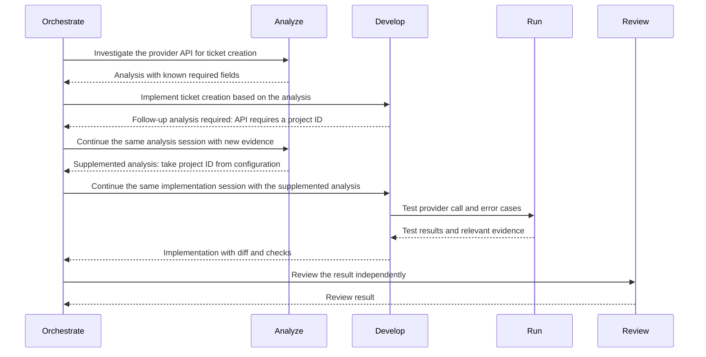

# Atlas

**Download here:** [Releases](https://github.com/DevelopingMedo/atlas/releases) — download `atlas.zip` from the newest `opencode-*` release (or an OpenCode-verified `v*` release).

## How to get started

Requirement: **OpenCode V2**. Download `atlas.zip` from the newest `opencode-*` release (see above) and extract it into `~/.config/opencode/`.

<details>
<summary><strong>macOS & Linux – show commands</strong></summary>

```sh
# Replace <opencode-tag> with the newest opencode-* tag from the releases page
curl -fL https://github.com/DevelopingMedo/atlas/releases/download/<opencode-tag>/atlas.zip -o atlas.zip
mkdir -p "$HOME/.config/opencode"
unzip -n atlas.zip -d "$HOME/.config/opencode/"
```

</details>

<details>
<summary><strong>Windows (PowerShell) – show commands</strong></summary>

```powershell
# Replace <opencode-tag> with the newest opencode-* tag from the releases page
Invoke-WebRequest -Uri "https://github.com/DevelopingMedo/atlas/releases/download/<opencode-tag>/atlas.zip" -OutFile "atlas.zip"
New-Item -ItemType Directory -Force -Path "$env:USERPROFILE\.config\opencode" | Out-Null
Expand-Archive -Path "atlas.zip" -DestinationPath "$env:USERPROFILE\.config\opencode"
```

</details>

Then open a new OpenCode session and run `/atlas init`.
Merge your existing own rules in `AGENTS.md` with the Atlas rules.

## Usage: Atlas skill

| Command | Function |
|---|---|
| `/atlas init` | Select models and save personal settings |
| `/atlas update [release tag]` | Update Atlas to the latest or a specific release |
| `/atlas models [filter]` | Show available models |
| `/atlas config` | Show personal configuration in readable form |

Examples:

```text
/atlas init Please only suggest models from my OpenAI provider
/atlas models openai
```

`/atlas` shows the help. Arguments in square brackets are optional.
Updates keep your `atlas.json` and local customizations; open a new session afterwards.

## What is Atlas?

**Clear roles carry complex tasks.**

Atlas provides agent roles for OpenCode. Each role receives exactly the information it needs for its task; results and important findings flow back to the appropriate role.

## The Core Idea

A good agent does not need to keep the entire conversation, every build log, and all tool responses in mind at once. Atlas distributes work across clearly described roles — not to save tokens at any cost, but to keep the context of a role as large as the task requires. New independent tasks begin with fresh context and a targeted handover, without the overall chat; related follow-up questions preferably go to the same specialist session. What comes back are the result, reliable evidence, and important new findings.

The name draws on the image of Atlas: complex tasks are carried by a traceable structure. The roles support one another; the orchestrator holds the overall task together.


## The Roles

| Role | Task |
|---|---|
| **Orchestrate** | Distribute work, classify results, and keep the user informed |
| **Plan** | Develop architecture, solution approaches, and work packages |
| **Analyze** | Investigate relationships and causes with evidence |
| **Develop** | Implement clearly delimited changes and add suitable tests |
| **Run** | Execute commands, tests, services, and MCP tasks together; condense large outputs and responses |
| **Review** | Independently check results for errors and regressions |
| **Auto** | Use nearly all tools without asking for confirmation and work on a task autonomously |

Auto works on tasks autonomously. Orchestrate coordinates tasks that benefit from targeted division of labor.

## When an implementation raises new questions

**Example:** A ticket bot is supposed to create tickets with a provider. During implementation, an API response shows an additional required field. The new evidence goes back to the original analysis session; afterwards, the same implementation session is preferably continued.



Every handover contains the specific task and the necessary evidence. Related follow-up questions preferably go to the same specialist session, so that earlier findings can be reused and new evidence can be checked. If it is not available, a new session receives a targeted replacement handover. The order of roles depends on the task; the example is not a mandatory pipeline. Details: [SUBAGENTS.md](SUBAGENTS.md).

## License

[Apache License 2.0 with Commons Clause 1.0](LICENSE).
