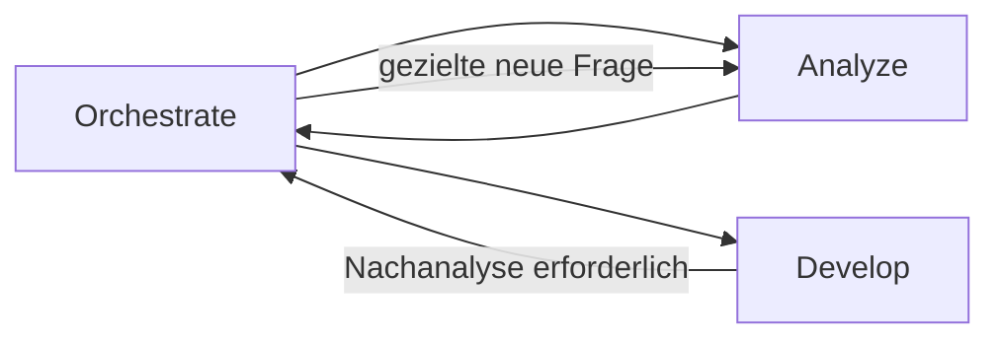

# Atlas

**Klare Rollen tragen komplexe Aufgaben.**

Atlas bietet klare Agent-Rollen für Claude Code. Frische Kontexte, gezielte Delegation und kompakte Übergaben halten größere Aufgaben übersichtlich. Planung, Analyse, Umsetzung und Ausführung greifen ineinander. Wichtige Erkenntnisse bleiben erhalten und erreichen die passende Rolle. Für transparente, fokussierte Zusammenarbeit.

## Der Grundgedanke

Ein guter Agent muss nicht die gesamte Unterhaltung, jeden Build-Log und alle Werkzeugantworten gleichzeitig im Kopf behalten. Atlas verteilt Arbeit auf klar beschriebene Rollen. Jeder delegierte Auftrag beginnt mit frischem Kontext und einer gezielten Übergabe. Zurück kommen das Ergebnis, belastbare Belege und wichtige neue Erkenntnisse.

Der Name greift das Bild des Atlas auf: Komplexe Aufgaben werden von einer nachvollziehbaren Struktur getragen. Die Rollen unterstützen einander; der Orchestrator hält den Gesamtauftrag zusammen.

## Die Rollen

| Rolle | Aufgabe |
|---|---|
| **Orchestrate** | Arbeit verteilen, Ergebnisse einordnen und den Nutzer auf dem Laufenden halten |
| **Plan** | Architektur, Lösungswege und Arbeitspakete entwickeln |
| **Analyze** | Zusammenhänge und Ursachen mit Belegen untersuchen |
| **Develop** | Abgegrenzte Änderungen umsetzen und passende Tests ergänzen |
| **Run** | Befehle, Tests, Dienste und MCP-Aufträge ausführen; große Ausgaben verdichten |
| **Review** | Ergebnisse unabhängig auf Fehler und Regressionen prüfen |
| **Auto** | Einen Auftrag vollständig selbst bearbeiten; Spezialisten optional nutzen |

Nicht jede Aufgabe braucht alle Rollen. Auto eignet sich für zusammenhängende Arbeit in einer Session. Orchestrate koordiniert die Aufgaben, die von gezielter Aufteilung profitieren.

## Kontext wird bei Bedarf geladen

Der globale Einstieg bleibt kurz. Ein Agent erhält sein eigenes Rollenprofil. Die Delegationsanleitung wird erst vor einer Delegation gelesen, die Artefaktanleitung bei großen Ausgaben. Git-Regeln sind bei Develop und Auto verankert und werden erst bei tatsächlicher Repository-Arbeit relevant.

Rohdaten bleiben beim ausführenden Spezialisten oder in gezielt referenzierten Artefakten. Wichtige Zusatzfunde dürfen dabei nicht verloren gehen: Der Parent bekommt Beleg, Bedeutung, Auswirkungen und offene Fragen. Im Hauptchat erscheinen kurze Ankündigungen und relevante Zwischenstände; der Nutzer muss keine Child-Sessions durchsuchen.

## Wenn eine Umsetzung neue Fragen aufwirft



Develop meldet eine Informationslücke oder eine widerlegte Annahme mit Belegen und aktuellem Arbeitsstand zurück. Orchestrate beauftragt eine frische Nachanalyse und gibt danach die aktualisierte Umsetzung weiter. Die nächste Rolle erhält gezielte Referenzen; ein kompletter alter Chat wird nicht weitergereicht.

## Repository-Struktur

```text
.
├── CLAUDE.md
├── SUBAGENTS.md
├── agents/       # Native Claude-Code-Rollen als Markdown
├── guide/        # ARTIFACTS.md und REPOSITORIES.md
├── README.md
├── LICENSE
└── .gitignore
```

Die Rollen verwenden das native Rollenformat von Claude Code. Modelle und persönliche MCP-Verbindungen sind nicht festgelegt.

## Global verwenden

Bestehende globale Regeln zuerst mit den Atlas-Regeln zusammenführen. Kopiere den Inhalt dieses Branches in das entsprechende Konfigurationsverzeichnis:

| Variante | Ziel |
|---|---|
| `claude` | `~/.claude/` |

Die internen Verweise setzen diesen Standardpfad voraus. Bei einem anderen Konfigurationsverzeichnis müssen sie angepasst werden. Danach eine neue Session beginnen.

**Claude Code:** Beispielsweise mit `claude --agent Orchestrate` oder `claude --agent Auto` starten. Die YAML-Profile verwenden native Tools und erben das Modell. Auto kann einen freizügigen Berechtigungsmodus der Hauptsession nutzen; ein Rollenprofil allein hebt die Berechtigungen der Hauptsession nicht an.

## Was die Dateien leisten

Atlas liefert Rollen, gemeinsame Arbeitsregeln und Bedarfsanleitungen. Die jeweilige Laufzeit bestimmt verfügbare Werkzeuge, Delegationstiefe und Berechtigungen. Wenn direkte Delegation nicht verfügbar ist, gibt die Rolle dem Parent eine konkrete Folgeanforderung zurück. Frischer Kontext, Zuständigkeiten und knappe Übergaben sind Anweisungen; sie ersetzen keine Laufzeitprüfung.

Bei tatsächlicher Git-Arbeit gehören nachvollziehbare Commits zur Übergabe. Temporäre Implementierungen ohne autorisierte Originaländerung entstehen in einer separaten Kopie. Ohne Git wird dafür kein Repository automatisch initialisiert.

Die Dateien wurden strukturell auf ihre nativen YAML- und Markdown-Formate, Verweise und Rollennamen geprüft. Claude-Code-Workflows sind noch nicht mit Modellläufen getestet. Persönliche Konfigurationen werden durch dieses Repository nicht automatisch installiert.

## Dokumentation

- [Claude Code: Custom subagents](https://code.claude.com/docs/en/sub-agents)
