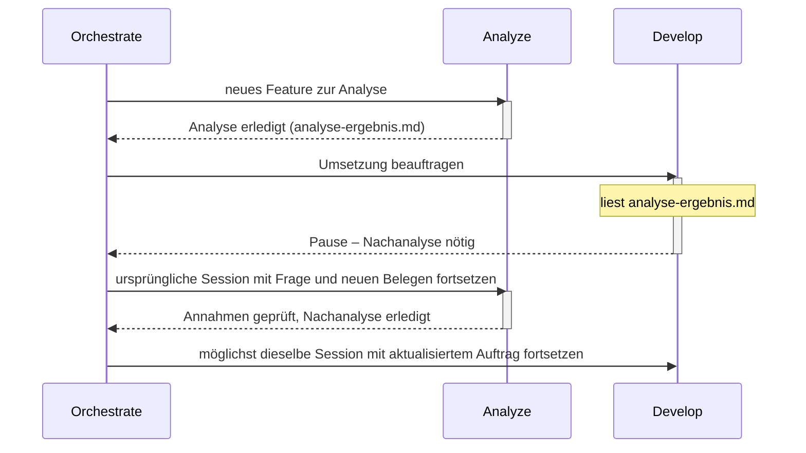

# Atlas

**Klare Rollen tragen komplexe Aufgaben.**

Atlas bietet klare Agent-Rollen für OpenCode. Frische Kontexte, gezielte Delegation und kompakte Übergaben halten größere Aufgaben übersichtlich. Planung, Analyse, Umsetzung und Ausführung greifen ineinander. Wichtige Erkenntnisse bleiben erhalten und erreichen die passende Rolle. Für transparente, fokussierte Zusammenarbeit.

## Der Grundgedanke

Ein guter Agent muss nicht die gesamte Unterhaltung, jeden Build-Log und alle Werkzeugantworten gleichzeitig im Kopf behalten. Atlas verteilt Arbeit auf klar beschriebene Rollen. Dabei geht es nicht darum, Tokens um jeden Preis zu sparen oder möglichst viele kleine Sessions zu erzeugen, sondern den Kontext einer Rolle so groß zu halten, wie die jeweilige Aufgabe es erfordert — bei einer komplexen Aufgabe darf und muss der Kontext entsprechend groß ausfallen. Neue eigenständige Aufgaben beginnen mit frischem Kontext und einer gezielten Übergabe, ohne Gesamtchat. Zusammengehörige Folgefragen gehen möglichst an dieselbe Fachsession. Zurück kommen das Ergebnis, belastbare Belege und wichtige neue Erkenntnisse.

Der Name greift das Bild des Atlas auf: Komplexe Aufgaben werden von einer nachvollziehbaren Struktur getragen. Die Rollen unterstützen einander; der Orchestrator hält den Gesamtauftrag zusammen.

## Die Rollen

| Rolle | Aufgabe |
|---|---|
| **Orchestrate** | Arbeit verteilen, Ergebnisse einordnen und den Nutzer auf dem Laufenden halten |
| **Plan** | Architektur, Lösungswege und Arbeitspakete entwickeln |
| **Analyze** | Zusammenhänge und Ursachen mit Belegen untersuchen |
| **Develop** | Abgegrenzte Änderungen umsetzen und passende Tests ergänzen |
| **Run** | Befehle, Tests, Dienste und MCP-Aufträge gemeinsam ausführen; große Ausgaben und Antworten verdichten |
| **Review** | Ergebnisse unabhängig auf Fehler und Regressionen prüfen |
| **Auto** | Ohne Rückfragen fast alle Werkzeuge nutzen und einen Auftrag eigenständig bearbeiten |
| **Build** | Wie Auto eigenständig arbeiten, aber vor jedem Shell-Befehl eine Nutzerbestätigung einholen |

Auto und Build eignen sich für zusammenhängende Arbeit in einer Session; Build fügt dabei eine Pflichtbestätigung vor jedem Shell-Befehl hinzu. Orchestrate koordiniert Aufgaben, die von gezielter Aufteilung profitieren. Ob Review dauerhaft als eigenständige Rolle bestehen bleibt oder nur noch begrenzt optional zum Einsatz kommt, ist offen; bis dahin gilt die Rolle unverändert wie oben beschrieben.

## Kontext wird bei Bedarf geladen

Der globale Einstieg bleibt kurz. Ein Agent erhält sein eigenes Rollenprofil. Die Delegationsanleitung wird erst vor einer Delegation gelesen, die Artefaktanleitung bei großen Ausgaben. Git-Regeln sind bei Develop und Auto verankert und werden erst bei tatsächlicher Repository-Arbeit relevant.

Rohdaten bleiben beim ausführenden Spezialisten oder in gezielt referenzierten Artefakten. Wichtige Zusatzfunde dürfen dabei nicht verloren gehen: Der Parent bekommt Beleg, Bedeutung, Auswirkungen und offene Fragen. Im Hauptchat erscheinen kurze Ankündigungen und relevante Zwischenstände; der Nutzer muss keine Child-Sessions durchsuchen.

Eine Fachsession wird nur bei erneutem fachlichem Bedarf aktualisiert, nicht laufend oder nach jeder Codeänderung. Eine Fortsetzung enthält die konkrete Frage, neue Belege und relevante Änderungen seit dem letzten Einsatz; Gegenbelege erfordern eine neue Prüfung bisheriger Annahmen. Ist die Session nicht verfügbar oder ungeeignet, gibt es eine neue gezielte Ersatzübergabe mit benanntem Kontextverlust, keine erfundene Session-ID. Die Einzelregeln stehen in [SUBAGENTS.md](SUBAGENTS.md).

Orchestrate ist die zuständige Stelle für diese Zuordnung: Es hält zu jedem Thema oder Arbeitspaket Rolle, tatsächliche Session-ID, Arbeitsstand, offene Fragen und Abhängigkeiten fest, damit ein neuer Befund der passenden bestehenden Fachsession zugeordnet werden kann statt einer austauschbaren Nummerierung. Bei längeren oder vielteiligen Vorgängen kommt dafür ein kleiner externer Checkpoint nach bestehender Projektkonvention hinzu, kein neues Verwaltungsframework.

## Wenn eine Umsetzung neue Fragen aufwirft



Develop meldet eine Informationslücke oder eine widerlegte Annahme mit neuen Belegen, relevanten Änderungen seit der letzten Analyse und aktuellem Arbeits-/Commitstand an seinen Parent zurück. Orchestrate setzt möglichst die ursprüngliche Analyze-Session fort und gibt danach die aktualisierte Umsetzung an möglichst dieselbe Develop-Session weiter. Hat Analyze selbst Develop beauftragt, geht die Meldung direkt an diesen ursprünglichen Analysten zurück: Er prüft seine Annahmen in seiner bestehenden Session neu und setzt danach möglichst dieselbe Develop-Session fort. Das ist eine Rückgabe an den Parent, keine Rückdelegation an einen weiteren Analyze. Größere Neuplanung oder Umfangserweiterung geht an den Auftraggeber zurück. Bei nicht verfügbaren oder ungeeigneten Sessions gilt die gezielte Ersatzübergabe mit benanntem Kontextverlust. Ein kompletter alter Chat wird nicht weitergereicht; zwischen den Einsätzen ist keine Synchronisierung nötig.

## Repository-Struktur

```text
.
├── AGENTS.md
├── SUBAGENTS.md
├── agents/       # Native OpenCode-V2-Rollen als Markdown
├── guide/        # Bedarfsanleitungen: ARTIFACTS.md, MCP.md, PLANNING.md, REPOSITORIES.md
├── README.md
├── LICENSE
└── .gitignore
```

Die Rollen verwenden das native Rollenformat von OpenCode. Modelle und persönliche MCP-Verbindungen sind nicht festgelegt.

## Global verwenden

Bestehende globale Regeln zuerst mit den Atlas-Regeln zusammenführen. Kopiere den Inhalt dieses Branches in das entsprechende Konfigurationsverzeichnis:

| Variante | Ziel |
|---|---|
| `opencode` | `~/.config/opencode/` |

Die internen Verweise sind repo-relativ und funktionieren unabhängig vom gewählten Konfigurationsverzeichnis. Danach eine neue Session beginnen.

**OpenCode V2:** Die Rollendateien werden direkt erkannt. Für den Standardstart kann in der bestehenden `opencode.json` der Wert `"default_agent": "Orchestrate"` ergänzt werden. Orchestrate, Plan, Auto und Build sind als Hauptagent vorgesehen; alle acht können delegiert werden. Eingebaute Rollen bleiben verfügbar, solange sie nicht in der eigenen Konfiguration deaktiviert werden.

MCP-Tools und -Ressourcen sind nur für Auto und Run freigegeben. Diese Rollenregel gilt für alle MCP-Server und alle Betriebssysteme. Andere Rollen delegieren MCP-Aufträge an Run. Rollenbezogene Berechtigungen blenden die Werkzeuge aus und sperren Aufrufe, schalten aber nicht die Serverprozesse ab. Persönliche Endpunkte, Zugangsdaten und rechnerabhängige Installationen bleiben außerhalb der allgemeinen Agent-Regeln. Details: [guide/MCP.md](guide/MCP.md).

## Was die Dateien leisten

Atlas liefert Rollen, gemeinsame Arbeitsregeln und Bedarfsanleitungen. Die jeweilige Laufzeit bestimmt verfügbare Werkzeuge, Delegationstiefe und Berechtigungen. Wenn direkte Delegation nicht verfügbar ist, gibt die Rolle dem Parent eine konkrete Folgeanforderung zurück. Frischer Kontext, Zuständigkeiten und knappe Übergaben sind Anweisungen; sie ersetzen keine Laufzeitprüfung.

Bei tatsächlicher Git-Arbeit gehören nachvollziehbare Commits zur Übergabe. Temporäre Implementierungen ohne autorisierte Originaländerung entstehen in einer separaten Kopie. Ohne Git wird dafür kein Repository automatisch initialisiert.

Die Rollendateien wurden strukturell auf ihre nativen Markdown-Formate, Verweise und Rollennamen geprüft. Ein vollständiger Modelllauf ist nicht dokumentiert. Persönliche Konfigurationen (Modelle, Provider, MCP-Verbindungen) bleiben Sache der eigenen OpenCode-Installation und sind nicht Teil dieses Repositorys.

## Dokumentation

- [OpenCode V2: Agents](https://dev.opencode.ai/v2/docs/agents/)
