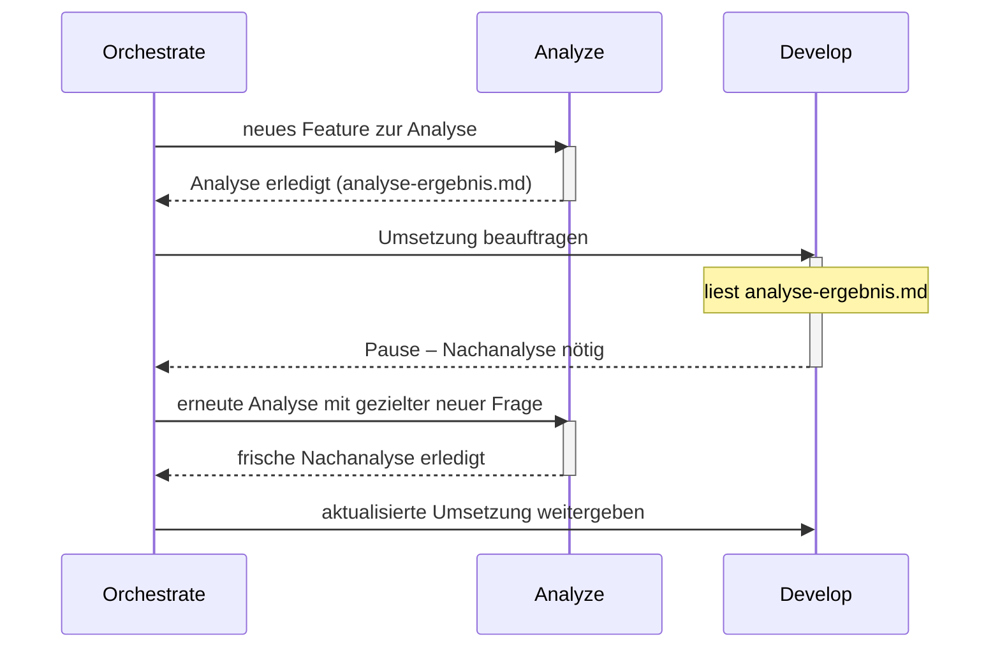

# Atlas

**Klare Rollen tragen komplexe Aufgaben.**

Atlas bietet klare Agent-Rollen für OpenCode. Frische Kontexte, gezielte Delegation und kompakte Übergaben halten größere Aufgaben übersichtlich. Planung, Analyse, Umsetzung und Ausführung greifen ineinander. Wichtige Erkenntnisse bleiben erhalten und erreichen die passende Rolle. Für transparente, fokussierte Zusammenarbeit.

## Der Grundgedanke

Ein guter Agent muss nicht die gesamte Unterhaltung, jeden Build-Log und alle Werkzeugantworten gleichzeitig im Kopf behalten. Atlas verteilt Arbeit auf klar beschriebene Rollen. Jeder delegierte Auftrag beginnt mit frischem Kontext und einer gezielten Übergabe. Zurück kommen das Ergebnis, belastbare Belege und wichtige neue Erkenntnisse.

Der Name greift das Bild des Atlas auf: Komplexe Aufgaben werden von einer nachvollziehbaren Struktur getragen. Die Rollen unterstützen einander; der Orchestrator hält den Gesamtauftrag zusammen.

## Die Rollen

| Rolle | Aufgabe |
|---|---|
| **Orchestrate** | Arbeit verteilen, Ergebnisse einordnen und den Nutzer auf dem Laufenden halten |
| **Plan** | Architektur, Lösungswege und Arbeitspakete entwickeln |
| **Analyze** | Zusammenhänge und Ursachen mit Belegen untersuchen |
| **Develop** | Abgegrenzte Änderungen umsetzen und passende Tests ergänzen |
| **Run** | Befehle, Tests und Dienste ausführen; große Ausgaben verdichten |
| **Review** | Ergebnisse unabhängig auf Fehler und Regressionen prüfen |
| **MCP** | Gezielte Aufträge über konfigurierte MCP-Server ausführen |
| **Auto** | Einen Auftrag vollständig selbst bearbeiten; Spezialisten optional nutzen |

Nicht jede Aufgabe braucht alle Rollen. Auto eignet sich für zusammenhängende Arbeit in einer Session. Orchestrate koordiniert die Aufgaben, die von gezielter Aufteilung profitieren.

## Kontext wird bei Bedarf geladen

Der globale Einstieg bleibt kurz. Ein Agent erhält sein eigenes Rollenprofil. Die Delegationsanleitung wird erst vor einer Delegation gelesen, die Artefaktanleitung bei großen Ausgaben. Git-Regeln sind bei Develop und Auto verankert und werden erst bei tatsächlicher Repository-Arbeit relevant.

Rohdaten bleiben beim ausführenden Spezialisten oder in gezielt referenzierten Artefakten. Wichtige Zusatzfunde dürfen dabei nicht verloren gehen: Der Parent bekommt Beleg, Bedeutung, Auswirkungen und offene Fragen. Im Hauptchat erscheinen kurze Ankündigungen und relevante Zwischenstände; der Nutzer muss keine Child-Sessions durchsuchen.

## Wenn eine Umsetzung neue Fragen aufwirft



Develop meldet eine Informationslücke oder eine widerlegte Annahme mit Belegen und aktuellem Arbeitsstand zurück. Orchestrate beauftragt eine frische Nachanalyse und gibt danach die aktualisierte Umsetzung weiter. Die nächste Rolle erhält gezielte Referenzen; ein kompletter alter Chat wird nicht weitergereicht.

## Repository-Struktur

```text
.
├── AGENTS.md
├── SUBAGENTS.md
├── agents/       # Native OpenCode-V2-Rollen als Markdown
├── guide/        # ARTIFACTS.md und REPOSITORIES.md
├── README.md
├── LICENSE
└── .gitignore
```

Die Rollen verwenden das native Rollenformat von OpenCode. Modelle und persönliche MCP-Verbindungen sind nicht festgelegt.

## Global verwenden

Bestehende globale Regeln zuerst mit den Atlas-Regeln zusammenführen. Kopiere den Inhalt dieses Branches in das entsprechende Konfigurationsverzeichnis:

| Variante | Ziel |
|---|---|
| `opencode` | `~/.config/opencode/` |

Die internen Verweise setzen diesen Standardpfad voraus. Bei einem anderen Konfigurationsverzeichnis müssen sie angepasst werden. Danach eine neue Session beginnen.

**OpenCode V2:** Die Rollendateien werden direkt erkannt. Für den Standardstart kann in der bestehenden `opencode.json` der Wert `"default_agent": "Orchestrate"` ergänzt werden. Orchestrate, Plan und Auto sind als Hauptagent vorgesehen; alle acht können delegiert werden. Eingebaute Rollen bleiben verfügbar, solange sie nicht in der eigenen Konfiguration deaktiviert werden.

MCP-Tools und -Ressourcen sind nur für Auto und MCP freigegeben. Diese Rollenregel gilt für alle MCP-Server und alle Betriebssysteme. Andere Rollen delegieren an MCP. Rollenbezogene Berechtigungen blenden die Werkzeuge aus und sperren Aufrufe, schalten aber nicht die Serverprozesse ab. Persönliche Endpunkte, Zugangsdaten und rechnerabhängige Installationen bleiben außerhalb der allgemeinen Agent-Regeln. Details: [guide/MCP.md](guide/MCP.md).

## Langdock einrichten (optional)

Die einzelne Datei [`install_langdock.py`](install_langdock.py) richtet den aktuellen
Langdock-Snapshot mit **18 Modellen** für OpenCode **v2.0.27** ein. Voraussetzungen:
OpenCode V2 bereits installiert/in `PATH`, Python 3.9+ und ein interaktives Terminal.
Keine zusätzlichen Python-Pakete und kein Download von OpenCode erforderlich.

```bash
# Linux / macOS
python3 install_langdock.py
```

```powershell
# Windows, in PowerShell
py install_langdock.py
```

Das Skript fragt **nur den API-Key** verdeckt ab. Es erstellt eine `.env` (Unix:
Modus `600`; Windows: ACL nur für den aktuellen Benutzer), die drei Provider mit
Umgebungsreferenz in `opencode.json` bzw. einer bestehenden `opencode.jsonc`,
Git-Ignore-Regeln und die `.env`-Lesesperren samt Agent-Anweisung. Die drei GPT-6-
Modelle verwenden die stateless Responses-API; GPT-5.6 ist nicht enthalten.

Auf Linux/macOS werden `.bashrc`, die verwendete Bash-Login-Datei und `.zshrc`
ergänzt (`ZDOTDIR` wird berücksichtigt, wenn exportiert). Unter Windows werden
die Benutzerprofile der installierten Windows PowerShell/PowerShell 7 ergänzt;
der Loader parst die Key-Zeile, ohne `.env` als Code auszuführen. CMD/Fish werden
nicht eingerichtet. Eine Windows-ExecutionPolicy, die Profile blockiert, wird
**nicht automatisch gelockert**. Bei aktiviertem Unix-Shell-Tracing lädt der
Loader keine Secrets.

Danach eine **neue Bash/Zsh bzw. PowerShell** öffnen und dort ausführen:

```text
opencode service restart
```

Anschließend OpenCode öffnen und `/models` verwenden. Das Skript startet keinen
Dienst neu und überträgt weder den Key noch andere Daten ins Netzwerk.

**Bestehende Daten:** Eine vorhandene `.env` wird niemals gelesen oder
überschrieben; dann bricht das Setup ab. Andere Provider, MCPs, Agents und
`default_agent` bleiben erhalten. Abweichende gleichnamige Langdock-Provider,
zwei parallele JSON/JSONC-Dateien oder bestehende Setup-Backups führen ebenfalls
zum Abbruch. Vor Änderungen an vorhandenen Dateien entstehen
`*.langdock.bak`-Backups (niemals von `.env`). JSONC-Kommentare bleiben im Backup;
die aktualisierte Datei wird als gültiges JSON formatiert. Die Installation ist
nicht über alle Dateien hinweg atomar; nach einem Schreibfehler helfen die
Backups bei der manuellen Wiederherstellung.

Auch auf Windows verwendet v2.0.27 standardmäßig `~/.config/opencode`.
`XDG_CONFIG_HOME` und `OPENCODE_CONFIG_DIR` werden berücksichtigt. Das Setup
kopiert **keine persönlichen MCP-Endpunkte oder Atlas-Agent-Dateien**. Die
Schutzregeln verwenden das in v2.0.27 erforderliche `experimental.policies`;
sie ersetzen keine Shell-Sandbox.

Tests (nur künstliche Testdaten, keine echte `.env` wird gelesen):

```bash
python3 -m unittest discover -s tests -p 'test_install_langdock.py' -v
```

## Was die Dateien leisten

Atlas liefert Rollen, gemeinsame Arbeitsregeln und Bedarfsanleitungen. Die jeweilige Laufzeit bestimmt verfügbare Werkzeuge, Delegationstiefe und Berechtigungen. Wenn direkte Delegation nicht verfügbar ist, gibt die Rolle dem Parent eine konkrete Folgeanforderung zurück. Frischer Kontext, Zuständigkeiten und knappe Übergaben sind Anweisungen; sie ersetzen keine Laufzeitprüfung.

Bei tatsächlicher Git-Arbeit gehören nachvollziehbare Commits zur Übergabe. Temporäre Implementierungen ohne autorisierte Originaländerung entstehen in einer separaten Kopie. Ohne Git wird dafür kein Repository automatisch initialisiert.

Die Rollendateien wurden strukturell auf ihre nativen Markdown-Formate, Verweise und Rollennamen geprüft. Ein vollständiger Modelllauf ist nicht dokumentiert. Persönliche Konfigurationen werden nur durch bewusstes Ausführen des optionalen Langdock-Installers ergänzt.

## Dokumentation

- [OpenCode V2: Agents](https://dev.opencode.ai/v2/docs/agents/)
