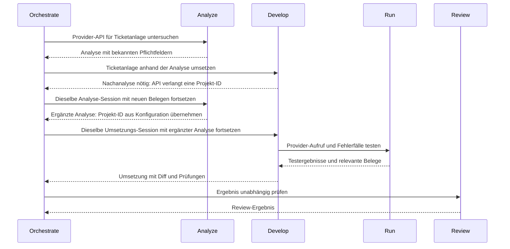

# Atlas

**Hier herunterladen:** [Neuestes Release](https://github.com/DevelopingMedo/atlas/releases/latest) · [atlas.zip](https://github.com/DevelopingMedo/atlas/releases/latest/download/atlas.zip)

## So startest du

Voraussetzung: **OpenCode V2**. Entpacke das ZIP nach `~/.config/opencode/`.

<details>
<summary><strong>macOS & Linux – Befehle anzeigen</strong></summary>

```sh
curl -fL https://github.com/DevelopingMedo/atlas/releases/latest/download/atlas.zip -o atlas.zip
mkdir -p "$HOME/.config/opencode"
unzip -n atlas.zip -d "$HOME/.config/opencode/"
```

</details>

<details>
<summary><strong>Windows (PowerShell) – Befehle anzeigen</strong></summary>

```powershell
Invoke-WebRequest -Uri "https://github.com/DevelopingMedo/atlas/releases/latest/download/atlas.zip" -OutFile "atlas.zip"
New-Item -ItemType Directory -Force -Path "$env:USERPROFILE\.config\opencode" | Out-Null
Expand-Archive -Path "atlas.zip" -DestinationPath "$env:USERPROFILE\.config\opencode"
```

</details>

Öffne danach eine neue OpenCode-Session und starte `/atlas init`.
Bestehende eigene Regeln in `AGENTS.md` mit den Atlas-Regeln zusammenführen.

## Usage: Atlas-Skill

| Befehl | Funktion |
|---|---|
| `/atlas init` | Modelle auswählen und persönliche Einstellungen speichern |
| `/atlas update [Release-Tag]` | Atlas auf das neueste oder ein bestimmtes Release aktualisieren |
| `/atlas models [Filter]` | Verfügbare Modelle anzeigen |
| `/atlas config` | Persönliche Konfiguration lesbar anzeigen |

Beispiele:

```text
/atlas init Bitte nur Modelle meines OpenAI-Providers vorschlagen
/atlas models openai
```

`/atlas` zeigt die Hilfe. Angaben in eckigen Klammern sind optional.
Updates erhalten deine `atlas.json` und lokale Anpassungen; danach eine neue Session öffnen.

## Was ist Atlas?

**Klare Rollen tragen komplexe Aufgaben.**

Atlas bietet Agent-Rollen für OpenCode. Jede Rolle erhält gezielt die Informationen, die sie für ihren Auftrag braucht; Ergebnisse und wichtige Erkenntnisse gehen an die passende Rolle zurück.

## Der Grundgedanke

Ein guter Agent muss nicht die gesamte Unterhaltung, jeden Build-Log und alle Werkzeugantworten gleichzeitig im Kopf behalten. Atlas verteilt Arbeit auf klar beschriebene Rollen — nicht um Tokens um jeden Preis zu sparen, sondern um den Kontext einer Rolle so groß zu halten, wie die Aufgabe es erfordert. Neue eigenständige Aufgaben beginnen mit frischem Kontext und gezielter Übergabe, ohne Gesamtchat; zusammengehörige Folgefragen gehen möglichst an dieselbe Fachsession. Zurück kommen Ergebnis, belastbare Belege und wichtige neue Erkenntnisse.

Der Name greift das Bild des Atlas auf: Komplexe Aufgaben werden von einer nachvollziehbaren Struktur getragen. Die Rollen unterstützen einander; der Orchestrator hält den Gesamtauftrag zusammen.


## Die Rollen

| Rolle | Aufgabe |
|---|---|
| **Orchestrate** | Arbeit verteilen, Ergebnisse einordnen und den Nutzer auf dem Laufenden halten |
| **Plan** | Architektur, Lösungswege und Arbeitspakete entwickeln |
| **Analyze** | Zusammenhänge und Ursachen mit Belegen untersuchen |
| **Develop** | Abgegrenzte Änderungen umsetzen und passende Tests ergänzen |
| **Run** | Befehle, Tests, Dienste und MCP-Aufträge gemeinsam ausführen; große Ausgaben und Antworten verdichten |
| **Review** | Ergebnisse unabhängig auf Fehler und Regressionen prüfen |
| **Auto** | Ohne Rückfragen fast alle Werkzeuge nutzen und einen Auftrag eigenständig bearbeiten |
| **Build** | Wie Auto eigenständig arbeiten, aber vor jedem Shell-Befehl eine Nutzerbestätigung einholen |

Auto und Build bearbeiten Aufträge eigenständig; Build fragt vor jedem Shell-Befehl nach. Orchestrate koordiniert Aufgaben, die von gezielter Aufteilung profitieren.

## Wenn eine Umsetzung neue Fragen aufwirft

**Beispiel:** Ein Ticket-Bot soll Tickets bei einem Provider anlegen. Während der Umsetzung zeigt eine API-Antwort ein zusätzliches Pflichtfeld. Die neuen Belege gehen zurück an die ursprüngliche Analyse-Session; anschließend wird möglichst dieselbe Umsetzungs-Session fortgesetzt.



Jede Übergabe enthält den konkreten Auftrag und die nötigen Belege. Zusammengehörige Rückfragen gehen möglichst an dieselbe Fachsession, damit frühere Erkenntnisse weiterverwendet und neue Belege geprüft werden. Ist sie nicht verfügbar, erhält eine neue Session eine gezielte Ersatzübergabe. Die Rollenfolge richtet sich nach der Aufgabe; das Beispiel ist keine Pflichtpipeline. Details: [SUBAGENTS.md](SUBAGENTS.md).

## Lizenz

[Apache License 2.0 mit Commons Clause 1.0](LICENSE).
