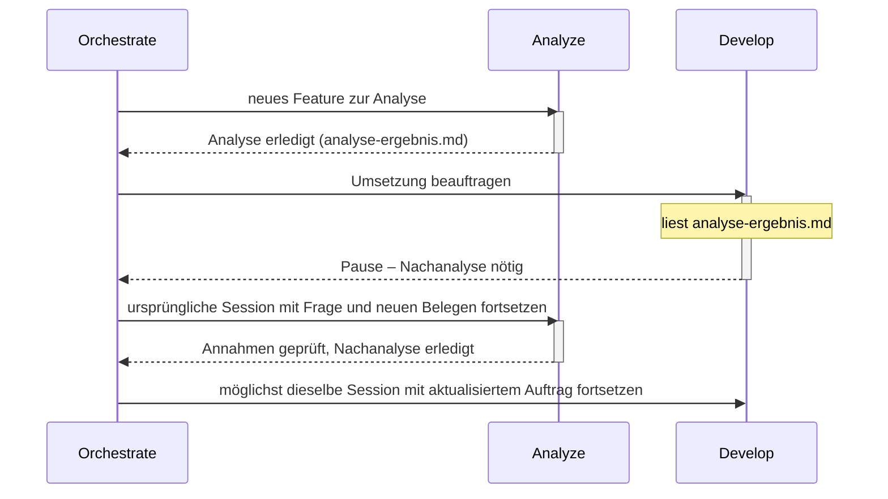

# Atlas

**Klare Rollen tragen komplexe Aufgaben.**

Atlas bietet klare Agent-Rollen für OpenCode. Frische Kontexte, gezielte Delegation und kompakte Übergaben halten größere Aufgaben übersichtlich. Planung, Analyse, Umsetzung und Ausführung greifen ineinander. Wichtige Erkenntnisse bleiben erhalten und erreichen die passende Rolle. Für transparente, fokussierte Zusammenarbeit.

## Der Grundgedanke

Ein guter Agent muss nicht die gesamte Unterhaltung, jeden Build-Log und alle Werkzeugantworten gleichzeitig im Kopf behalten. Atlas verteilt Arbeit auf klar beschriebene Rollen. Neue eigenständige Aufgaben beginnen mit frischem Kontext und einer gezielten Übergabe, ohne Gesamtchat. Zusammengehörige Folgefragen gehen möglichst an dieselbe Fachsession. Zurück kommen das Ergebnis, belastbare Belege und wichtige neue Erkenntnisse.

Der Name greift das Bild des Atlas auf: Komplexe Aufgaben werden von einer nachvollziehbaren Struktur getragen. Die Rollen unterstützen einander; der Orchestrator hält den Gesamtauftrag zusammen.

## Die Rollen

Acht Rollen stehen bereit; nicht jede Aufgabe braucht alle.

| Rolle | Aufgabe |
|---|---|
| **Orchestrate** | Arbeit verteilen, Ergebnisse einordnen und den Nutzer auf dem Laufenden halten |
| **Plan** | Architektur, Lösungswege und Arbeitspakete entwickeln |
| **Analyze** | Zusammenhänge und Ursachen mit Belegen untersuchen |
| **Develop** | Abgegrenzte Änderungen umsetzen und passende Tests ergänzen |
| **Run** | Befehle, Tests, Dienste und MCP-Aufträge gemeinsam ausführen; große Ausgaben und Antworten verdichten |
| **Review** | Ergebnisse unabhängig auf Fehler und Regressionen prüfen |
| **Auto** | Einen Auftrag vollständig selbst bearbeiten; Spezialisten optional nutzen |
| **Build** | Wie Auto eigenständig arbeiten, aber vor jedem Shell-Befehl eine Nutzerbestätigung einholen |

Auto und Build eignen sich für zusammenhängende Arbeit in einer Session; Build fügt dabei eine Pflichtbestätigung vor jedem Shell-Befehl hinzu. Orchestrate koordiniert Aufgaben, die von gezielter Aufteilung profitieren. Ob Review dauerhaft als eigenständige Rolle bestehen bleibt oder nur noch begrenzt optional zum Einsatz kommt, ist eine offene Entscheidung (siehe „Offene Entscheidungen“ unten); bis dahin gilt die Rolle unverändert wie oben beschrieben.

## Drei Einstiege: Build, Orchestrate, Auto

Atlas ist ein Arbeitsmodell für die Zusammenarbeit der Rollen, kein einzelnes Werkzeug. Für denselben Auftrag gibt es drei direkt startbare Einstiege, die sich in ihrer Selbstständigkeit unterscheiden:

- **Build** – beaufsichtigt: Arbeitet wie Auto eigenständig an einem zusammenhängenden Auftrag, verlangt aber vor jedem Shell-Befehl eine ausdrückliche Nutzerbestätigung, auch bei eigener Ausführung. Diese Pflicht gilt unbedingt und wird nicht durch eine Delegation an `Run`, `Develop` oder `Auto` umgangen.
- **Orchestrate** – koordinierend: Standard-Einstieg für mehrteilige Aufträge. Verteilt Arbeit an Fachrollen, führt deren belegte Ergebnisse zusammen und implementiert nicht selbst.
- **Auto** – weitgehend autonom: ein bewusst gewählter universeller Modus, der einen zusammenhängenden Auftrag vollständig selbst plant, analysiert, umsetzt und prüft; Spezialisten und Delegation bleiben optional. Seine bestehenden Rechte sind unverändert.

Alle drei bleiben Fachrollen unter denselben globalen Regeln: dieselbe Secret-Behandlung, dieselbe Sessionwahl nach `SUBAGENTS.md`, wenn sie delegieren, und derselbe Rückweg bei Blockern – eine konkrete Rückgabe an den Auftraggeber statt eines improvisierten Workarounds. Welcher Einstieg passt, entscheidet die gewünschte Beaufsichtigung: Build für ausdrückliche Zustimmung zu jedem Shell-Befehl, Orchestrate für nachvollziehbare Aufteilung mit unabhängigen Belegen, Auto für durchgehende Eigenständigkeit in einer Session. Die übrigen fünf Rollen – Plan, Analyze, Develop, Run, Review – stehen allen drei Einstiegen zur Delegation offen (siehe Rollentabelle); Plan ist zusätzlich selbst als direkt startbare Rolle vorgesehen (siehe „Global verwenden“).

## Kontext wird bei Bedarf geladen

Der globale Einstieg bleibt kurz. Ein Agent erhält sein eigenes Rollenprofil. Die Delegationsanleitung wird erst vor einer Delegation gelesen, die Artefaktanleitung bei großen Ausgaben. Git-Regeln sind bei Develop und Auto verankert und werden erst bei tatsächlicher Repository-Arbeit relevant.

Rohdaten bleiben beim ausführenden Spezialisten oder in gezielt referenzierten Artefakten. Wichtige Zusatzfunde dürfen dabei nicht verloren gehen: Der Parent bekommt Beleg, Bedeutung, Auswirkungen und offene Fragen. Im Hauptchat erscheinen kurze Ankündigungen und relevante Zwischenstände; der Nutzer muss keine Child-Sessions durchsuchen.

Eine Fachsession wird nur bei erneutem fachlichem Bedarf aktualisiert, nicht laufend oder nach jeder Codeänderung. Eine Fortsetzung enthält die konkrete Frage, neue Belege und relevante Änderungen seit dem letzten Einsatz; Gegenbelege erfordern eine neue Prüfung bisheriger Annahmen. Ist die Session nicht verfügbar oder ungeeignet, gibt es eine neue gezielte Ersatzübergabe mit benanntem Kontextverlust, keine erfundene Session-ID. Die Einzelregeln stehen in [SUBAGENTS.md](SUBAGENTS.md).

Orchestrate ist die zuständige Stelle für diese Zuordnung: Es hält zu jedem Thema oder Arbeitspaket Rolle, tatsächliche Session-ID, Arbeitsstand, offene Fragen und Abhängigkeiten fest, damit ein neuer Befund der passenden bestehenden Fachsession zugeordnet werden kann statt einer austauschbaren Nummerierung. Bei längeren oder vielteiligen Vorgängen kommt dafür ein kleiner externer Checkpoint nach bestehender Projektkonvention hinzu, kein neues Verwaltungsframework.

## Wenn eine Umsetzung neue Fragen aufwirft



Develop meldet eine Informationslücke oder eine widerlegte Annahme mit neuen Belegen, relevanten Änderungen seit der letzten Analyse und aktuellem Arbeits-/Commitstand an seinen Parent zurück. Orchestrate setzt möglichst die ursprüngliche Analyze-Session fort und gibt danach die aktualisierte Umsetzung an möglichst dieselbe Develop-Session weiter. Hat Analyze selbst Develop beauftragt, geht die Meldung direkt an diesen ursprünglichen Analysten zurück: Er prüft seine Annahmen in seiner bestehenden Session neu und setzt danach möglichst dieselbe Develop-Session fort. Das ist eine Rückgabe an den Parent, keine Rückdelegation an einen weiteren Analyze. Größere Neuplanung oder Umfangserweiterung geht an den Auftraggeber zurück. Bei nicht verfügbaren oder ungeeigneten Sessions gilt die gezielte Ersatzübergabe mit benanntem Kontextverlust. Ein kompletter alter Chat wird nicht weitergereicht; zwischen den Einsätzen ist keine Synchronisierung nötig.

## Repository-Struktur

```text
.
├── AGENTS.md
├── SUBAGENTS.md
├── agents/       # Native OpenCode-V2-Rollen als Markdown
├── guide/        # Bedarfsanleitungen: ARTIFACTS.md, MCP.md, PLANNING.md, REPOSITORIES.md
├── docs/decisions/  # Offene Entscheidungsvorlagen (siehe "Offene Entscheidungen")
├── README.md
├── LICENSE
└── .gitignore
```

Die Rollen verwenden das native Rollenformat von OpenCode. Modelle und persönliche MCP-Verbindungen sind nicht festgelegt.

## Global verwenden

Bestehende globale Regeln zuerst mit den Atlas-Regeln zusammenführen. Kopiere den Inhalt dieses Branches in das entsprechende Konfigurationsverzeichnis:

| Variante | Ziel |
|---|---|
| `opencode` | `~/.config/opencode/` |

Die internen Verweise setzen diesen Standardpfad voraus. Bei einem anderen Konfigurationsverzeichnis müssen sie angepasst werden. Danach eine neue Session beginnen.

**OpenCode V2:** Die Rollendateien werden direkt erkannt. Für den Standardstart kann in der bestehenden `opencode.json` der Wert `"default_agent": "Orchestrate"` ergänzt werden. Orchestrate, Plan, Auto und Build sind als Hauptagent vorgesehen; alle acht können delegiert werden. Eingebaute Rollen bleiben verfügbar, solange sie nicht in der eigenen Konfiguration deaktiviert werden.

MCP-Tools und -Ressourcen sind nur für Auto und Run freigegeben. Diese Rollenregel gilt für alle MCP-Server und alle Betriebssysteme. Andere Rollen delegieren MCP-Aufträge an Run. Rollenbezogene Berechtigungen blenden die Werkzeuge aus und sperren Aufrufe, schalten aber nicht die Serverprozesse ab. Persönliche Endpunkte, Zugangsdaten und rechnerabhängige Installationen bleiben außerhalb der allgemeinen Agent-Regeln. Details: [guide/MCP.md](guide/MCP.md).

## Langdock einrichten (optional)

Die einzelne Datei [`install_langdock.py`](install_langdock.py) richtet den aktuellen
Langdock-Snapshot mit **18 Modellen** für OpenCode **v2.0.27** ein. Voraussetzungen:
OpenCode V2 bereits installiert/in `PATH`, Python 3.9+ und ein interaktives Terminal.
Keine zusätzlichen Python-Pakete und kein Download von OpenCode erforderlich.

```bash
# Linux / macOS
python3 install_langdock.py
```

```powershell
# Windows, in PowerShell
py install_langdock.py
```

Das Skript fragt **nur den API-Key** verdeckt ab. Es erstellt eine `.env` (Unix:
Modus `600`; Windows: ACL nur für den aktuellen Benutzer), die drei Provider mit
Umgebungsreferenz in `opencode.json` bzw. einer bestehenden `opencode.jsonc`,
Git-Ignore-Regeln und die `.env`-Lesesperren samt Agent-Anweisung. Die drei GPT-6-
Modelle verwenden die stateless Responses-API; GPT-5.6 ist nicht enthalten.

Auf Linux/macOS werden `.bashrc`, die verwendete Bash-Login-Datei und `.zshrc`
ergänzt (`ZDOTDIR` wird berücksichtigt, wenn exportiert). Unter Windows werden
die Benutzerprofile der installierten Windows PowerShell/PowerShell 7 ergänzt;
der Loader parst die Key-Zeile, ohne `.env` als Code auszuführen. CMD/Fish werden
nicht eingerichtet. Eine Windows-ExecutionPolicy, die Profile blockiert, wird
**nicht automatisch gelockert**. Bei aktiviertem Unix-Shell-Tracing lädt der
Loader keine Secrets.

Danach eine **neue Bash/Zsh bzw. PowerShell** öffnen und dort ausführen:

```text
opencode service restart
```

Anschließend OpenCode öffnen und `/models` verwenden. Das Skript startet keinen
Dienst neu und überträgt weder den Key noch andere Daten ins Netzwerk.

**Bestehende Daten:** Eine vorhandene `.env` wird niemals gelesen oder
überschrieben; dann bricht das Setup ab. Andere Provider, MCPs, Agents und
`default_agent` bleiben erhalten. Abweichende gleichnamige Langdock-Provider,
zwei parallele JSON/JSONC-Dateien oder bestehende Setup-Backups führen ebenfalls
zum Abbruch. Vor Änderungen an vorhandenen Dateien entstehen
`*.langdock.bak`-Backups (niemals von `.env`). JSONC-Kommentare bleiben im Backup;
die aktualisierte Datei wird als gültiges JSON formatiert. Die Installation ist
nicht über alle Dateien hinweg atomar; nach einem Schreibfehler helfen die
Backups bei der manuellen Wiederherstellung.

Auch auf Windows verwendet v2.0.27 standardmäßig `~/.config/opencode`.
`XDG_CONFIG_HOME` und `OPENCODE_CONFIG_DIR` werden berücksichtigt. Das Setup
kopiert **keine persönlichen MCP-Endpunkte oder Atlas-Agent-Dateien**. Die
Schutzregeln verwenden das in v2.0.27 erforderliche `experimental.policies`;
sie ersetzen keine Shell-Sandbox.

Tests (nur künstliche Testdaten, keine echte `.env` wird gelesen):

```bash
python3 -m unittest discover -s tests -p 'test_install_langdock.py' -v
```

## Was die Dateien leisten

Atlas liefert Rollen, gemeinsame Arbeitsregeln und Bedarfsanleitungen. Die jeweilige Laufzeit bestimmt verfügbare Werkzeuge, Delegationstiefe und Berechtigungen. Wenn direkte Delegation nicht verfügbar ist, gibt die Rolle dem Parent eine konkrete Folgeanforderung zurück. Frischer Kontext, Zuständigkeiten und knappe Übergaben sind Anweisungen; sie ersetzen keine Laufzeitprüfung.

Bei tatsächlicher Git-Arbeit gehören nachvollziehbare Commits zur Übergabe. Temporäre Implementierungen ohne autorisierte Originaländerung entstehen in einer separaten Kopie. Ohne Git wird dafür kein Repository automatisch initialisiert.

Die Rollendateien wurden strukturell auf ihre nativen Markdown-Formate, Verweise und Rollennamen geprüft. Ein vollständiger Modelllauf ist nicht dokumentiert. Persönliche Konfigurationen werden nur durch bewusstes Ausführen des optionalen Langdock-Installers ergänzt.

## Offene Entscheidungen

Zwei Entscheidungsvorlagen sind nach den bisherigen Umsetzungspaketen noch unentschieden; sie ändern bislang weder Rollen noch Berechtigungen:

- [`docs/decisions/11-auto-selection.md`](docs/decisions/11-auto-selection.md): ob Auto weiterhin frei delegierbar bleibt (Variante A, heutiger Stand) oder künftig eine bewusste Auswahl bzw. ausdrückliche Freigabe braucht (Variante B, Empfehlung). Bis zur Entscheidung gilt unverändert die heutige freie Delegierbarkeit.
- [`docs/decisions/12-review-role.md`](docs/decisions/12-review-role.md): ob die eigenständige Review-Rolle entfällt (Variante A) oder als begrenzte optionale Fehlersuche erhalten bleibt (Variante B, Empfehlung). Bis zur Entscheidung bleibt Review unverändert nutzbar wie in der Rollentabelle beschrieben.

Beide Vorlagen beschreiben ausdrücklich eine Empfehlung, keinen Beschluss; die endgültige Entscheidung trifft der Nutzer in einem eigenen, separaten Auftrag.

## Dokumentation

- [OpenCode V2: Agents](https://dev.opencode.ai/v2/docs/agents/)
